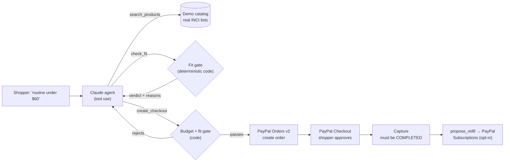

# ShelfCheck

**Skincare that knows your skin.** An AI shopping agent that scans your face, buys only products your skin can use, stays on your budget, and checks out with PayPal. You approve every dollar.

> Try it without a selfie: open the app and choose **Try it with a sample skin**.

## The problem

People with sensitive, acne-prone or redness-prone skin buy skincare by trial and error. They read marketing claims, not ingredient lists, and a product that makes skin worse is usually opened, unreturnable money lost. An AI agent could shop for them, but nobody should hand an LLM their card and hope it reads labels correctly.

## What ShelfCheck does

1. **Measures your skin.** One selfie runs YouCam AI Skin Analysis: 11 scores (acne, redness, pores, hydration, oiliness, texture, lines, spots, dark circles, radiance, firmness).
2. **Shops for you.** Ask in plain words: *"Build me a full routine under $60"*. The agent searches the store, checks every ingredient list against your scores, rules out what would aggravate your weak spots, and builds the cart.
3. **Checks out with PayPal.** The agent creates a PayPal order (Orders v2). You approve it in PayPal Checkout, and the server captures it. Nothing is charged without you.
4. **Never lets you run out.** The agent proposes a refill cadence ("the serum runs out first, in about 6 weeks"). Opt in with **PayPal Subscriptions**. The plan is built from your completed order and is cancellable anytime in PayPal.
5. **Reacted? Refunded, and replaced.** If a product disagrees with your skin within 30 days, refund just that item through PayPal. If it's on auto-refill, the agent immediately finds a replacement and, once you approve, revises your PayPal subscription.
6. **Re-checked before every refill.** Rescan (or, in the demo, "Simulate a re-scan 6 weeks later"), and the agent re-scores your routine against your new skin and proposes swaps.
7. **Plus:** barcode or label check for any product, the 26 EU-listed fragrance allergens flagged, skin simulation of your goal, shade match and makeup try-on.

## Trust: the AI chooses, code enforces



| Guardrail | Where it lives |
|---|---|
| A product that aggravates a concern you score below 55 on can't be bought | `check_fit` / `create_checkout` in `src/lib/shopper.ts`, scoring in `src/lib/ingredients.ts` |
| The cart can't exceed your stated budget | `parseBudget()` + `create_checkout` (code, not prompt) |
| One order per run; retries can't double-create | run-level guard + `PayPal-Request-Id` idempotency keys in `src/lib/paypal.ts` |
| Prices come only from the server catalog | `priceCart()` in `src/lib/paypal.ts` |
| Paid means PayPal says `COMPLETED` | `captureOrder()` checks order and capture status |
| Refills only for completed orders, one plan per order and cadence | `src/lib/subscriptions.ts` reads the order back from PayPal |
| A human approves every payment, subscription and subscription change | PayPal Buttons and approval links (`src/components/shop/CartPanel.tsx`, `src/components/shop/OrderCard.tsx`) |
| Only the shopper who paid can refund, set up or change a refill | server-signed order/subscription tokens (`src/lib/sign.ts`) required by refund, refill and revise routes |
| Refunds only for items actually in the order, at the price paid, within 30 days, once per item | `refundItem()` reads the order from PayPal; `PayPal-Request-Id` per item |
| A refunded product can never return in a refill; the re-check must keep every routine step and stay within +15% of the refill price | `propose_routine` gate in `src/lib/recheck.ts`, re-validated in `src/app/api/routine/revise/route.ts` |

Every product the agent rules out is shown in the cart with its reason, so you can see the guardrails working.

## PayPal integration

| Capability | API |
|---|---|
| Order creation by the agent, with line items, SKUs, breakdown, `experience_context` (brand, `PAY_NOW`, shipping from file) | Orders v2 via `@paypal/paypal-server-sdk` |
| Buyer approval | PayPal JS SDK Buttons via `@paypal/react-paypal-js` |
| Capture with status verification | Orders v2 capture |
| Refill product and billing plan, created from the completed order | Catalog Products API + Billing Plans API |
| Subscription approval (first refill starts one interval later) and verification | JS SDK subscription buttons + `GET /v1/billing/subscriptions/{id}` |
| Reaction-guarantee refund of a single item | Payments v2 `POST /v2/payments/captures/{id}/refund` (partial, idempotent) |
| Swapping products in an active refill after the agent's re-check | Subscriptions `POST /v1/billing/subscriptions/{id}/revise` with buyer approval, then plan verified |

Runs against the PayPal **sandbox**: a demo store with illustrative prices and test money only.

## Why an LLM and not a filter?

The fit check and budget are plain code. The agent is there for what code can't do well: understanding requests like "something gentle for my redness, I already have a cleanser", trading off price against fit across categories, explaining each choice in terms of your own scores, and deciding a refill cadence from what's in the cart.

## Tech

- **AI:** Claude (`claude-opus-5-5`) via the Anthropic API with tool use (`search_products`, `check_fit`, `create_checkout`, `propose_refill`); also label reading and explanations.
- **PayPal:** Orders v2, JS SDK Buttons, Catalog Products, Billing Plans, Subscriptions (sandbox).
- **YouCam (Perfect Corp):** AI Skin Analysis, Facial Color Tones, Skin Simulation, Makeup Virtual Try-On.
- **Data:** [Open Beauty Facts](https://world.openbeautyfacts.org) for ingredient lists and product images (ODbL / CC BY-SA); EU Regulation 1223/2009 Annex III for the 26 fragrance allergens.
- **App:** Next.js 15, TypeScript, Tailwind CSS.

## Run locally

Requires Node 20+.

```bash
cp .env.example .env.local
npm install
npm run dev
```

Fill `.env.local` with `ANTHROPIC_API_KEY`, `PAYPAL_CLIENT_ID` and `PAYPAL_CLIENT_SECRET` (sandbox app from developer.paypal.com), and optionally `YOUCAM_API_KEY`. Without a YouCam key, use **Try it with a sample skin**, or set `YOUCAM_MOCK=1`. To pay, log in to the PayPal popup with a sandbox **personal** test account from your PayPal developer dashboard.

## Project structure

- `src/lib/shopper.ts`: the shopping agent, its tools and guardrails
- `src/lib/paypal.ts`: Orders v2 create and capture, server-side pricing
- `src/lib/subscriptions.ts`: refill plans and subscription verification
- `src/lib/ingredients.ts`: ingredient knowledge base, EU allergens, fit scoring
- `src/lib/youcam.ts`, `src/lib/tone.ts`: skin analysis, tone, simulation, try-on
- `src/data/catalog.json`: demo store (24 real products with Open Beauty Facts ingredient lists)
- `src/app/api/*`: server routes; API keys never reach the browser
- `src/components/*`: UI

## Built for the PayPal AI Hackathon

All of ShelfCheck was built during the hackathon's submission period (it opened Oct 1, 2026; the first code was written Oct 26). It started as a skin-scan and ingredient-check prototype and was never submitted to any other competition. The shopping agent, the code-enforced budget and fit gates, PayPal Orders checkout, PayPal Subscriptions refills, the shopper-first redesign and the sample-skin mode followed. See the commit history.

## Notes

Not medical advice; patch-test new products. Demo store only: not affiliated with or endorsed by the brands shown; prices are illustrative.

## License

MIT. See [LICENSE](LICENSE).
